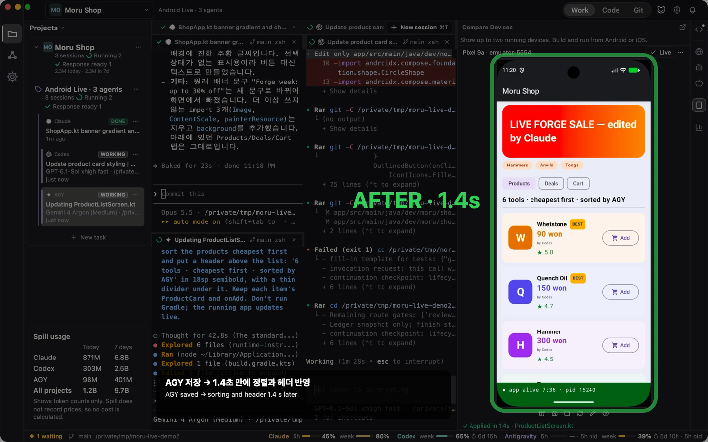

# Android Live

English | [한국어](README.ko.md)

> **Alpha.** Expect rough edges: some changes still need a rebuild, and behavior may change between versions.

Saves reach the running Android app in about a second, with no reinstall and no restart. Even with Claude, Codex and
AGY editing at the same time, each save shows up on the screen right away.

## What it does

- Text, layout, style, new screens and new files, business logic and button behavior change in the running app.
- Only what changed is redrawn, so other screens' state and ViewModel state stay as they were.
- A compile error is shown with its location, and the app keeps running what it had.
- Resources (strings.xml, images), the manifest and Gradle files are reported as needing a rebuild; one **Rebuild**
  and Live continues.

## Where to use it

Turn on `Live` in an Android device's header in Moru's Devices tool. The result shows in one line under the mirror.

## Requirements

- Android SDK (adb, build-tools) and JDK 17 or later
- A debug build on an Android 12 or later device or emulator
- For a Jetpack Compose app, the screen redraws as well

## Known limits

- `remember` state inside the composable you edited resets.
- An app restarted outside Live needs a rebuild.
