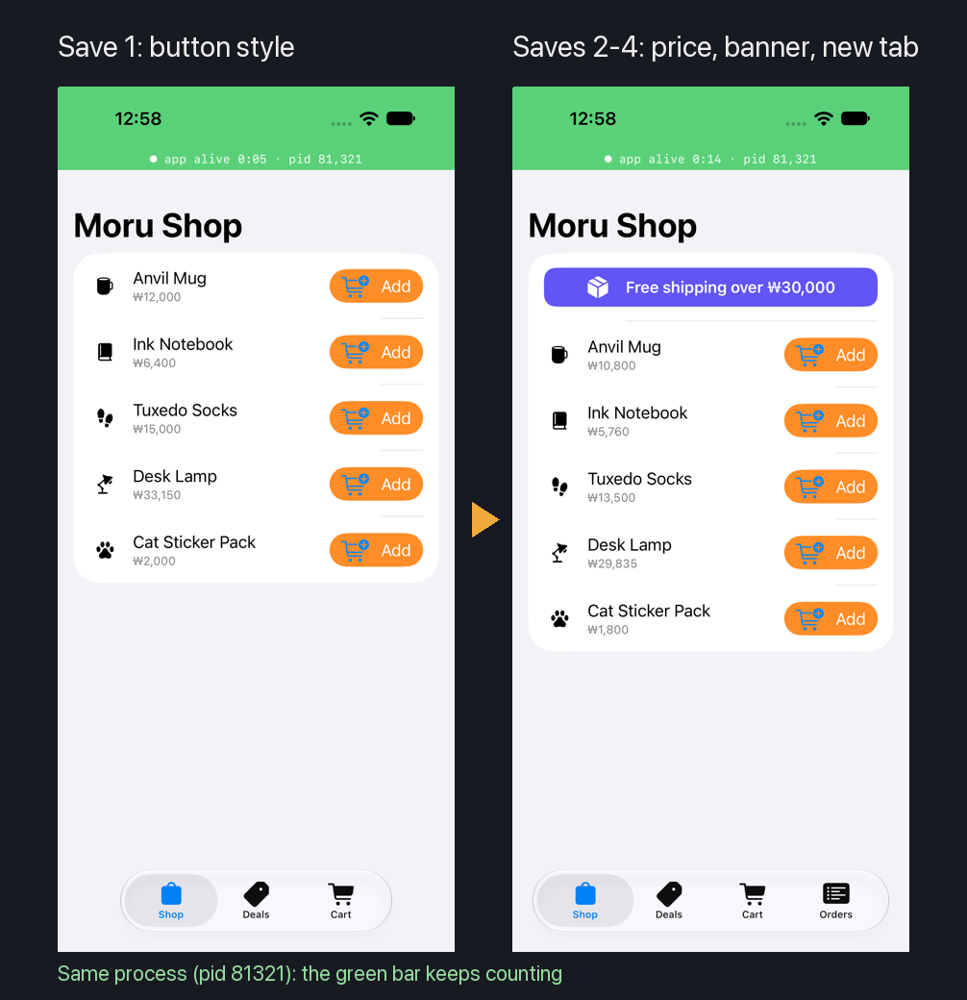

# iOS Live

English | [한국어](README.ko.md)

> **Alpha.** Expect rough edges: some changes still need a rebuild, and behavior may change between versions.

Save a Swift file and the SwiftUI app running in the iOS Simulator shows the change in about a second, in the same
process, with its state kept. No reinstall, no restart.

## What it does

- A view's `body`, functions, computed properties and business logic change in the running app.
- New views and new files work too, such as a new tab added to the bottom navigation.
- Every SwiftUI view redraws, List rows included; `@State` and other stored state stay.
- A compile error is shown with its location, and the app keeps running the last good code.
- A change that needs new storage (a stored property added or removed, a type or file deleted) rebuilds and relaunches
  the app by itself.

## Where to use it

Open a Task whose project has an `.xcodeproj` or `.xcworkspace`, then turn on `Live` for a simulator or a connected iPhone in Moru's Devices
tool. The first run builds the app (seconds); each save after that takes about a second.

## Requirements

- Xcode 16 or later with an iOS Simulator
- A SwiftUI app; the plugin builds the first scheme in Debug into its own folder and does not change the project

## Known limits

- Physical iPhones need a development team in the project's Signing settings; on hardware this is not yet verified.
- UIKit screens change only after they redraw on their own.
